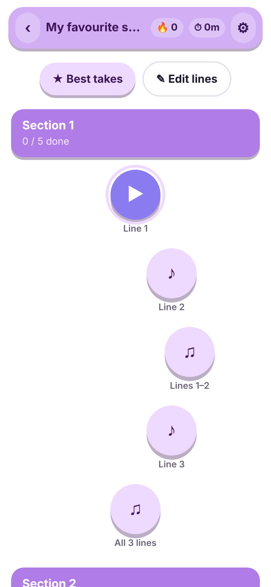
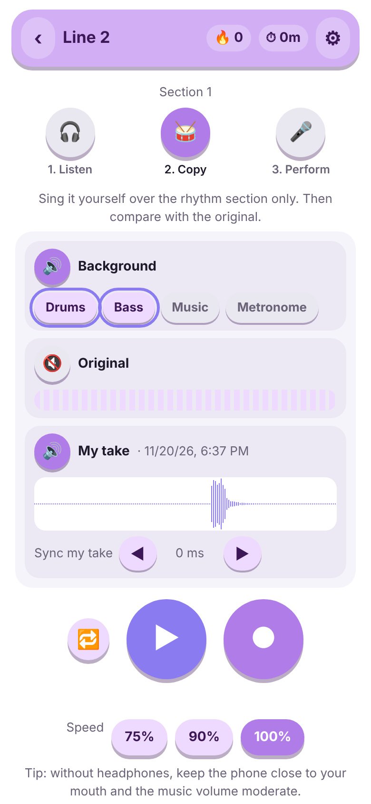
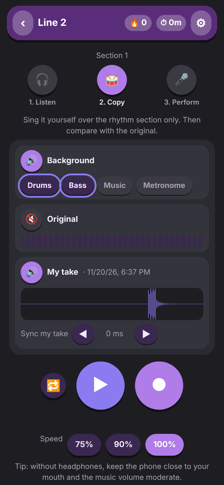
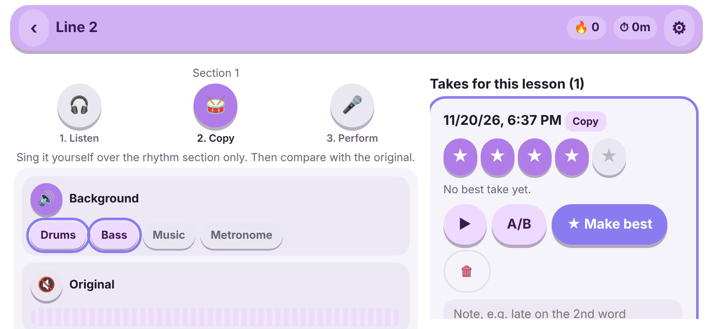
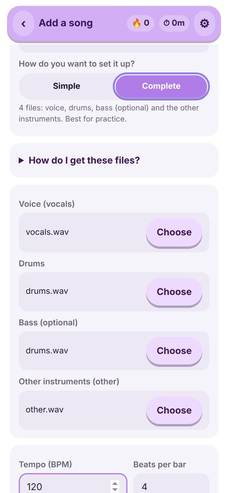
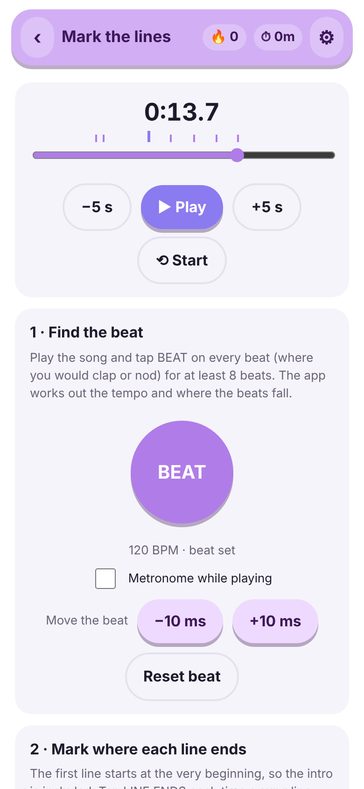
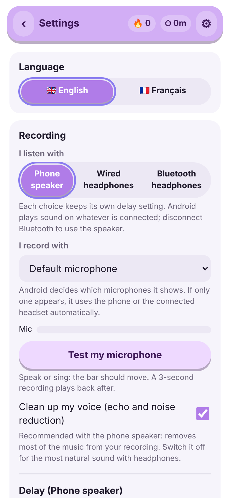

# Vocal Rhythm Trainer

Vocal Rhythm Trainer is an Android app to help you train on staying in rhythm when you sing. You can train on any song, you can even upload your own! Use it at home or on the go, available anywhere from your phone and even offline. 🎤🥁

**[⬇ Jump to the installation](#download)**

<p align="center">
  
  
  
</p>

## Features

- **🇬🇧 English and 🇫🇷 French.** You choose the language the first time you open the app, and you can change it anytime in the settings.
- **Any song, including your own.** Import the song split into stems (separate tracks). The app explains step by step how to get them for free, with Moises on your phone or Ultimate Vocal Remover on a computer.
- **Two ways to set up a song:**
    - **Simple:** the original song plus the instrumental. A metronome replaces the drums.
    - **Complete:** voice, drums, bass (optional) and other instruments.
- **Lessons like Duolingo.** Each song becomes a path of round lesson buttons, grouped by section (verse, chorus…): line 1, line 2, lines 1–2, line 3, line 4, lines 3–4, all lines, and finally the whole song.
- **Three steps per lesson:**
    1. **Listen:** the full song, voice included.
    2. **Copy:** sing over the drums and bass, or the metronome.
    3. **Perform:** sing over the whole instrumental.
- **Record and compare by ear.**
    - Background, Original and My take each have their own mute button, so you can layer them however you like. There's also an A/B mode: the original, then your take.
    - The original voice's waveform is hidden on purpose, so you train your ears and not your eyes.
- **Metronome and count-in.** You can turn on a metronome during the line, and there's a spoken count-in ("1, 2, 3, 4" or "un, deux, trois, quatre"). You can also record your own count-in.
- **Speed control.** Practise at 75%, 90% or 100% without changing the pitch.
- **Rate yourself.** Give each take 1 to 5 stars, add a note, and keep your best take. A lesson is complete when you rate a Perform take with enough stars.
- **Best-takes run-through.** Your best take of every line is stitched over the instrumental into one full performance, which you can export as an audio file.
- **Easy line marking.** Tap along to find the beat, then tap where each line ends. A scrub bar lets you move around the song, and you can fine-tune with − / + buttons (hold them to go faster).
- **Works with or without headphones.**
    - A live microphone meter and a mic test.
    - A delay setting for the phone speaker, wired headphones and Bluetooth.
    - Optional voice cleanup, automatic volume levelling, and a "sync my take" nudge.
- **Motivation.** A daily streak, minutes practised per day and per week, and an optional daily reminder.
- **Portrait or landscape.** Landscape gives a bigger, two-column training view.
- **Light and dark mode**, following your phone.
- **Private.** Everything stays on your phone. You can back up and restore through a single file, for example to Google Drive.

<p align="center">
  
</p>

<p align="center">
  
  
  
</p>

## Download

1. On your Android phone, open the **[latest release](https://github.com/elisehoi/VocalRythmTrainer/releases/latest)** and download the `.apk` file.
2. Tap the downloaded file to install it. The first time, Android asks you to allow "install unknown apps" for your browser or file manager. Allow it, then go back and tap the file again.
3. Open **Rhythm Trainer**, choose your language, and add your first song.

> Tip: use **Settings → Backup** now and then. Your takes are stored only on your phone, and uninstalling the app deletes them.

## If you prefer to build it on your own

You need a computer with Linux, macOS or Windows (with WSL). The commands below are for Linux or macOS.

### 1. Install the tools

**Node.js 22 or newer** (here with nvm):
```bash
curl -o- https://raw.githubusercontent.com/nvm-sh/nvm/v0.40.3/install.sh | bash
source ~/.bashrc          # or restart the terminal
nvm install 22
```

**Java 21:**
```bash
sudo apt install openjdk-21-jdk                         # Ubuntu / Debian
export JAVA_HOME=/usr/lib/jvm/java-21-openjdk-amd64     # adjust if your folder name differs: ls /usr/lib/jvm/
```

**Android SDK** (command-line tools only, no Android Studio needed):
1. Download the "Command line tools only" zip for your system from https://developer.android.com/studio#command-line-tools-only
2. Unpack it into the right folder and install the SDK parts:
```bash
mkdir -p ~/Android/Sdk/cmdline-tools
cd ~/Android/Sdk/cmdline-tools
unzip ~/Downloads/commandlinetools-*_latest.zip
mv cmdline-tools latest

export ANDROID_HOME=$HOME/Android/Sdk
export PATH=$ANDROID_HOME/cmdline-tools/latest/bin:$ANDROID_HOME/platform-tools:$PATH

yes | sdkmanager --licenses
sdkmanager "platform-tools" "platforms;android-36" "build-tools;36.0.0"
```

To keep these settings in every new terminal, add the three `export` lines (`JAVA_HOME`, `ANDROID_HOME`, `PATH`) to the end of your `~/.bashrc`.

### 2. Get the code and its dependencies

```bash
git clone https://github.com/elisehoi/VocalRythmTrainer.git
cd VocalRythmTrainer
npm install
```

### 3. Build the APK

```bash
npm run build
npx cap sync android
cd android
./gradlew assembleDebug
```

The APK is at `android/app/build/outputs/apk/debug/app-debug.apk`.

### 4. Install it on your phone

Either copy the APK to your phone (USB cable, Google Drive…) and tap it, or install it over USB. For USB, turn on **Developer options → USB debugging** on the phone first:
```bash
adb install -r app/build/outputs/apk/debug/app-debug.apk
```
The `-r` flag installs it as an update, so your songs and takes are kept.

> An APK you build yourself is signed with your computer's own debug key. Android only installs an update over an app signed with the same key. If you switch between a self-built APK and the one from Releases, uninstall first, and make a backup before you do.

### Optional extras

- **Natural count-in voice:** `pip install piper-tts && python3 scripts/make_count_voice.py` generates new count-in files in `public/count/` with the open-source Piper voices. Rebuild afterwards.
- **Signed release build:** create a key with `keytool -genkey -v -keystore rhythm-release.jks -alias rhythm -keyalg RSA -keysize 2048 -validity 10000`. Set `KEYSTORE_PATH`, `KEYSTORE_PASSWORD`, `KEY_ALIAS` and `KEY_PASSWORD`, then run `./gradlew assembleRelease`.
- **Automatic builds:** every push to `main` builds the APK with GitHub Actions (`.github/workflows/android.yml`) and publishes it under Releases. To sign those builds, add the same four values as repository secrets, with the key file base64-encoded as `KEYSTORE_BASE64`.

### Code overview

| Path | What it is |
| --- | --- |
| `src/audio.ts` | Playback, time-stretching, beat grid, metronome and count-in, microphone recording, delay calibration |
| `src/lessons.ts` | Turns a song's sections and lines into the lesson path |
| `src/i18n.ts` | English and French texts |
| `src/db.ts` | On-device storage (songs, takes, settings, stats) |
| `src/views/` | The screens: home, song path, lesson, line marking, line editor, best takes, settings |
| `android/` | Capacitor Android project (permissions, icon, signing) |
